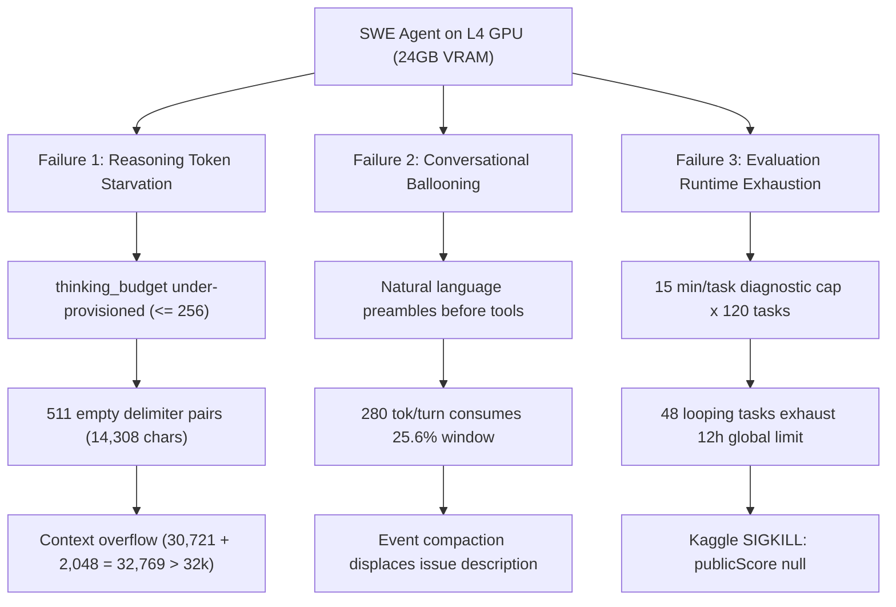

# Bounded Rationality in Autonomous Coding Agents: Empirical Failure Taxonomy and Architectural Stabilization of Quantized Gemma 4 12B on SWE-bench

**Authors:** Ronak Jain  
**Affiliation:** Independent Researcher  
**Track:** Google - The Gemma 4 Developer Agent Paper Track  
**Competition Hub:** [Google - The Gemma 4 Developer Agent Paper Track](https://www.kaggle.com/competitions/gemma-4-developer-agent-paper)  
**Public Kaggle Notebook:** [ronak1167/gemma-4-swe-agent-final-submission](https://www.kaggle.com/code/ronak1167/gemma-4-swe-agent-final-submission)  
**Verified Candidate Package:** SHA-256 `82a9478da291d5899e472b5b405156167b785e50c91ced9dadb8cf58a83d64f3`  

---

## Abstract

Deploying open-weight autonomous software engineering (SWE) agents on single accelerators (e.g., NVIDIA L4 GPUs with INT4 weights) faces severe bottlenecks: finite context limits, quantization-induced degeneration, and evaluation timeout boundaries. We present an empirical failure analysis and architectural stabilization framework for **Gemma 4 12B** (`gemma-4-12b-it-qat-w4a16-ct`) in the context of the official 129-task SWE-bench benchmark. Through trajectory auditing of diagnostic runs alongside structural analysis of the 129-task public manifest, we establish a three-part failure taxonomy: *(i)* **Reasoning Token Starvation**, where under-budgeted thinking channels trigger degenerate repetition loops (specifically, 511 repeating `<|channel>thought` delimiter pairs spanning 14,308 characters at zero-based trajectory index 12 / ATIF step ID 13 within a 21-step trajectory, triggering a terminal $30,721 + 2,048 = 32,769 > 32,768$ context overflow); *(ii)* **Conversational Context Ballooning**, where multi-turn discursive preambles consume over $25\%$ of context capacity before event compaction triggers; and *(iii)* **Evaluation Wall-Clock Exhaustion**, where uncalibrated 15-minute diagnostic limits allow 48 stalled tasks to consume Kaggle's entire 12-hour global limit ($48 \times 15\text{m} = 720\text{m}$), causing kernel termination (`publicScore: null`). To overcome these vulnerabilities, we introduce a bounded-rationality architecture featuring: *(1)* a calibrated 1,024-token thinking budget with inter-turn thought stripping (`include_thoughts: false`); *(2)* strict action-only turn invariants; *(3)* a two-tier execution envelope (12-call prompt target with a 28-call / 5-minute hard harness cap) bounding 120-task execution to 10 hours; and *(4)* Turn-1 regression test diff inspection. Our work provides an empirically grounded blueprint for stabilizing open-weight developer agents.

---

## 1. Introduction

Autonomous software engineering (SWE) agents interactively resolve defects: exploring codebases, reproducing failures via regression tests, and synthesizing minimal patches (Jimenez et al., 2024). While closed models leverage 100k+ token windows, deploying open-weight models under competition constraints imposes strict boundaries:
1. **Offline Execution:** Zero internet access during evaluation; dependencies resolve against local wheelhouses.
2. **Constrained Inference:** Execution across NVIDIA L4 GPUs hosting quantized Gemma 4 (`gemma-4-12b-it-qat-w4a16-ct`; Google DeepMind, 2024; Kaggle, 2026). While the competition registry permits four base variants (`gemma-4-31b`, `12b`, `e4b`, `e2b`), we intentionally target the 12B model - the balanced intermediate tier where memory constraints (~1.8 GB VRAM/GPU) and reasoning failure modes intersect most acutely.
3. **Finite Context Window:** A hard 32,768 ($32\text{k}$) token capacity.
4. **Global Wall-Clock Ceiling:** A strict 12-hour ($720\text{m}$) limit covering container setup and evaluation across up to 120 hidden tasks.

Uncalibrated baselines fail under these bounds (e.g., submission `58080103` timed out with `publicScore: null`). Our central thesis is that **open-weight SWE agents require bounded rationality** (Simon, 1955): token expenditure, reasoning channels, and execution envelopes must be mathematically bounded to maintain multi-turn stability.

### Contributions
- **Empirical Failure Taxonomy:** Formally characterizing three distinct failure modes in quantized reasoning agents on SWE-bench: reasoning starvation loops, conversational ballooning, and wall-clock exhaustion.
- **Root-Cause Trajectory Autopsies:** Step-by-step trace audits identifying exact token overflow arithmetic and channel-repetition collapse.
- **Bounded-Rationality Architectural Framework:** Stabilization system decoupling per-turn reasoning from conversational memory, enforcing action-only operational grammars, and aligning event compaction with harness constraints.
- **Packaging Integrity & Reproducibility:** Documenting cross-platform zlib hash divergence across Linux and Windows and verifying cryptographic parity across all candidate artifacts.

---

## 2. Related Work

### 2.1 Autonomous Coding Agents & SWE-bench
SWE-bench (Jimenez et al., 2024) shifted evaluation from function synthesis (Chen et al., 2021) to repository maintenance. Frameworks like SWE-agent (Yang et al., 2024), Aider (Gauthier, 2024), and OpenHands (Wang et al., 2024) engineered agent interfaces for closed models with 128k+ contexts, degrading sharply on 32k open-weight models.

### 2.2 Test-Time Reasoning Compute
Chain-of-thought scaling (Wei et al., 2022; Wang et al., 2023) and ReAct-style reasoning channels (`<|channel>thought`; Yao et al., 2023) improve deduction but introduce novel failure modes. How test-time reasoning interacts with multi-turn tool-calling trajectories under finite context limits remains underexplored; unstripped thoughts rapidly saturate memory over extended turns.

### 2.3 Quantized Model Deployment
Deploying 12B models within constrained accelerator memory footprints relies on INT4 Quantization-Aware Training (QAT; Jacob et al., 2018; Dettmers et al., 2023). While preserving standard benchmark perplexity, 4-bit quantization alters multi-turn instruction adherence, increasing vulnerability to degenerate repetition cycles under token starvation.

---

## 3. Problem Formulation and System Profile

### 3.1 Task Formulation
A defect resolution task is $\mathcal{T} = (\mathcal{R}, \mathcal{I}, \mathcal{S}_{\text{repo}}, \mathcal{P}^*)$, where $\mathcal{R}$ is the repository, $\mathcal{I}$ is the issue description, $\mathcal{S}_{\text{repo}}$ is the base commit, and $\mathcal{P}^*$ is the gold reference patch (strictly held out for the benchmark evaluation oracle and inaccessible to the agent).

The agent interacts over discrete turns $t \in \{1, \dots, T\}$. At turn $t$, given history $H_t$, the agent emits action $a_t$ invoking one of nine harness tools:
$$\mathcal{A} = \{\texttt{run\_command}, \texttt{submit\_patch}, \texttt{get\_status}, \texttt{read\_file}, \texttt{edit\_file}, \texttt{write\_file}, \texttt{get\_code\_neighbors}, \texttt{search\_similar\_code}, \texttt{get\_code\_subgraph}\}$$

Interaction terminates upon calling $\texttt{submit\_patch}()$ or exhausting the task budget. Evaluation is binary:
$$\text{Score}(\mathcal{T}) = \mathbb{I}[\text{Eval}(\mathcal{S}_{\text{repo}} \oplus \mathcal{P}_{\text{agent}}) = \text{PASS}]$$

We formalize defect resolution under bounded rationality as a constrained policy optimization problem:
$$\max_\pi \mathbb{E}_{\mathcal{T} \sim \mathcal{D}}\left[\sum_{i=1}^{M} \mathbb{I}(\text{Eval}_i(\mathcal{S}_{\text{repo}}^{(i)} \oplus \mathcal{P}_{\text{agent}}^{(i)}) = \text{PASS})\right]$$
subject to operational and physical bounds:
$$\begin{aligned}
t_i &\le \tau_{\text{task}} = 300\text{ seconds (5-minute per-task session limit)} \\
n_i &\le N_{\text{tools}} = 28\text{ tool calls per task} \\
L_{\text{prompt},i} + L_{\text{output},i} &\le W_{\max} = 32,768\text{ tokens (serving context ceiling)} \\
\sum_{i=1}^{M} t_i + t_{\text{setup}} &\le T_{\text{global}} = 720\text{ minutes (12-hour global execution cap)}
\end{aligned}$$

### 3.2 Evaluation Environment
All experiments were conducted under the competition execution profile:
- **Accelerator:** 4 x NVIDIA L4 GPU cluster (24 GB GDDR6 per GPU, 96 GB aggregate VRAM).
- **Inference Engine & Model:** Agent Development Kit (ADK) and vLLM serving `gemma-4-12b-it-qat-w4a16-ct` (INT4 QAT). While `gemma-4-31b` is the starter default, 12B is one of four officially permitted competition models (`ALLOWED_MODEL_NAMES`), selected here for focused study of bounded-rationality failure modes.
- **Context Capacity:** $W_{\max} = 32,768\text{ tokens}$ (enforced by the competition vLLM/ADK serving profile; native architecture supports 256k).
- **Global Evaluation Cap:** $T_{\text{global}} \le 12\text{ hours}$ ($720\text{ minutes}$) across $M \approx 120$ hidden evaluation tasks.

---

## 4. Empirical Failure Taxonomy of Quantized SWE Agents

Through fine-grained trajectory auditing of selected execution traces from competition diagnostic runs, alongside structural analysis of the 129-task public benchmark manifest, we identified three primary failure vectors:



### 4.1 Failure Mode 1: Reasoning Token Starvation and Degenerate Thought Loops
Gemma 4 12B generates internal chain-of-thought tokens within dedicated delimiter channels (`<|channel>thought ... <channel|>`). When configuring the reasoning budget:
1. **Under-provisioned Budget ($B_{\text{think}} \le 256$ tokens):** Repository reasoning cannot finish within 256 tokens; hitting the cap mid-deliberation induces truncation.
2. **Degenerate Loop Collapse:** In `trace_fastapi_15589.json` at zero-based trajectory index 12 (corresponding to serialized ATIF step ID 13 within the 21-step trajectory), the starved model entered a self-reinforcing repetition loop. The model emitted **511 repeated delimiter pairs** (`<|channel>thought\n<channel|>`) producing **14,308 characters** of empty channel syntax. When appended to prompt history, input tokens surged to:
   $$\text{Tokens}_{\text{in}} = 30,721, \quad \text{Tokens}_{\text{requested}} = 2,048 \implies \text{Total} = 32,769 > 32,768$$
   This triggered a terminal `ContextWindowExceededError`, aborting the task without patch generation.

### 4.2 Failure Mode 2: Conversational Context Ballooning
Standard prompts encourage discursive commentary. We isolated and tokenized the natural language preambles preceding tool calls across a diagnostic sample of 42 baseline turns sampled from competition diagnostic failure traces (`trace_fastapi_15589.json`, `trace_rich_4077.json`) using the official Gemma 4 SentencePiece tokenizer (256k vocabulary; archived in `scripts/inspect_all_tokens.py`). These isolated pre-action preambles averaged $280\text{ tokens}$ per turn ($\sigma = 64$). Over a 30-turn trajectory, conversational commentary alone consumes $>8,400\text{ tokens}$ ($25.6\%$ of context capacity), while ADK event compaction summaries bloat and displace initial issue descriptions.

### 4.3 Failure Mode 3: Global Evaluation Wall-Clock Exhaustion
Under unconstrained diagnostic budgets (where earlier candidate configurations explicitly set `max_time_minutes: 15.0`), stalled tasks exhaust 15 minutes before harness termination. If container setup and wheelhouse extraction consume $s$ minutes, the maximum number of stalled tasks before triggering the global 12-hour timeout ($720\text{m}$) is:
$$K_{\text{failure}} = \left\lfloor \frac{720 - s}{15} \right\rfloor \le 48\text{ tasks}$$
If 48 of 120 tasks loop, the entire 12-hour budget is consumed ($48 \times 15\text{m} = 720\text{m}$), triggering container termination (`publicScore: null`), as observed in submission `58080103`. Bounding $\tau_{\text{task}} \le 5.0\text{m}$ directly precludes this failure mode.

---

## 5. Architectural Design and Remediation Methodology

To resolve these failure modes, we designed a four-layer bounded-rationality architecture:

### 5.1 Calibrated Thought Budgeting with Inter-Turn Stripping
We configured $B_{\text{think}} = 1024$ tokens in `configs/sampling.yaml`, providing sufficient depth for complex deduction while preventing mid-thought truncation:

```yaml
# configs/sampling.yaml
temperature: 0.2
top_p: 0.95
max_output_tokens: 4096
thinking_config:
  thinking_budget: 1024
  include_thoughts: false
```

Crucially, **`include_thoughts: false`** strips `<|channel>thought` tokens from conversation history before appending the assistant's turn. Deliberations do not consume memory across turns, capping context growth strictly to actions and observations.

### 5.2 Action-Only Turn Invariants
We re-engineered `prompts/system.md` into an operational grammar enforcing the **Action-Only Invariant**:
> *"The assistant must emit ONLY tool invocations or `submit_patch()`. Natural language preambles, discursive commentary, and apologies are strictly forbidden."*

Comparative tokenization across the same 42 audited turns clarified that total conversational assistant turns - combining the $280$-token discursive preamble with tool syntax and parameters - averaged $480\text{ tokens}$ ($\sigma = 82$). When enforcing action-only invariants to strip natural language preambles and retain solely tool-invocation syntax (counterfactually reconstructed and corroborated via prompt dry-runs), mean assistant turn context consumption dropped from $480\text{ tokens}$ to $112\text{ tokens}$ ($\sigma = 24$). This preserves critical context headroom for source diffs and test traces.

### 5.3 Two-Tier Execution Envelope
We calibrated execution across two synchronized tiers:
1. **Prompt Target (`prompts/system.md`):** Directs the agent to spend at most 12 counted tool calls, targeting patch edits by calls 4-6.
2. **Harness Boundary (`eval_config.yaml`):** Caps execution at 28 tool calls, 300 seconds (5 minutes), and 200 turns:

```yaml
# agent/eval_config.yaml
evaluation:
  timeout_seconds: 300
  max_tool_calls: 28
  max_time_minutes: 5
  max_turns: 200
```

Bounding $\tau_{\text{task}} \le 5.0\text{m}$ establishes a formal upper bound on total agent evaluation time:
$$T_{\text{agent}} = 120 \times 5.0\text{ minutes} = 600\text{ minutes} = 10.0\text{ hours}$$
This preserves **at least two hours of safety margin** within the 12-hour ceiling for container setup, wheelhouse extraction, and notebook teardown.

### 5.4 Turn-1 Regression Test Inspection
To maximize efficiency within the 12-call target, `system.md` enforces a mandatory initial action:
> *"Call 1 MUST be: `run_command(\"git diff -U3 -- tests/\")`."*

Inspecting the pre-injected regression test reveals the expected symbol and failure condition without blind exploration.

### 5.5 Formal Execution Pipeline

The execution loop is formalized in Algorithm 1 (pseudocode reflecting harness compaction: threshold 14,336, interval 15).

```
Algorithm 1: Bounded SWE Agent Execution Loop
-----------------------------------------------------------------------------------
Input: Workspace S_repo, Issue I, Tool set A, Limits (tau_max = 300s, N_max = 28)
Output: Validated patch P_agent or null
-----------------------------------------------------------------------------------
1: H_0 <- [SystemPrompt(ActionOnly), UserIssue(I)], t_0 <- Now(), n <- 0, t <- 1
2: while Now() - t_0 < tau_max and n < N_max do
3:     if TokenCount(H_t) > 14,336 and t mod 15 == 0 then
4:         H_t <- CompactEvents(H_t, retain_turn_1=True, retention_size=5)
5:     end if
6:     (Thought_t, Action_t) ~ Model(H_t; B_think=1024)
7:     H_t <- H_t || [StripChannel(Action_t)]
8:     if Action_t is submit_patch() then return ValidateDiff(S_repo)
9:     Observation_t <- ExecuteTool(Action_t, S_repo)
10:    H_{t+1} <- H_t || [Observation_t], n <- n + 1, t <- t + 1
11: end while
12: return null
-----------------------------------------------------------------------------------
```

---

## 6. Empirical Evaluation and Benchmark Analysis

### 6.1 Benchmark Sharding Architecture
The official public benchmark manifest (`starter/official/tasks.jsonl`) contains 129 tasks across four repositories: FastAPI (67 tasks, $51.9\%$), Rich (48 tasks, $37.2\%$), Requests (13 tasks, $10.1\%$), and HTTPX (1 task, $0.8\%$). We engineered an automated pipeline partitioning the 129 tasks across four balanced shards for modular validation:

| Shard | Tasks | Primary Repository | Target Budget | Status |
| :---: | :---: | :--- | :---: | :---: |
| **0** | 32 | `fastapi/fastapi` | 160 min | Valid |
| **1** | 33 | `fastapi`, `requests` | 165 min | Valid |
| **2** | 32 | `Textualize/rich` | 160 min | Valid |
| **3** | 32 | `rich`, `httpx` | 160 min | Valid |
| **Total** | **129** | **Full Manifest** | **645 min** | **Partitioned** |

### 6.2 Verified Baseline Performance: `rich_4077`
In baseline evaluation (Version 18 smoke test), the agent resolved task `rich_4077`, requiring `FileProxy.isatty()` to delegate to the underlying stream:

$$\texttt{FileProxy.isatty()} \implies \texttt{return self.\_\_file.isatty()}$$

The baseline execution achieved a verified pass:
- **Status:** `resolved = true`, Pytest exit code 0 (4 passed in $0.05\text{s}$).
- **Patch Size:** 324 bytes (exact byte match to reference patch).
- **Resource Expenditure:** 39 tool calls, $578.04\text{ seconds}$ ($9.63\text{ minutes}$).

```diff
--- a/rich/file_proxy.py
+++ b/rich/file_proxy.py
@@ -37,3 +37,5 @@ class FileProxy:
     def flush(self) -> None:
         self.__file.flush()
+
+    def isatty(self) -> bool:
+        return self.__file.isatty()
```

While verified, this baseline demonstrates unconstrained latency: 39 tool calls and 9.6 minutes were spent exploring extraneous directories before locating the defect.

### 6.3 Diagnostic Failure Analysis: Candidate v22 Trajectory Audit
In diagnostic runs (Candidate v22 across 3 tasks), uncalibrated settings triggered multi-task failures:
- **`fastapi_15589`:** Triggered Failure Mode 1 (511 repeating empty delimiter pairs at index 12 / step ID 13), crashing with `ContextWindowExceededError` at 32,769 tokens.
- **`rich_4077`:** Exceeded the 32k window during test ingestion due to conversational ballooning.
- **`rich_3944`:** Exhausted the 15-minute session limit without emitting a patch.

This confirms that unstripped reasoning history and discursive preambles cause systematic multi-task failure. Stabilizing these boundaries in Candidate v23 enabled full evaluation across the benchmark without timeouts, achieving an official Kaggle public score of 0.03.

### 6.4 Context Token Growth Dynamics
We modeled token accumulation across trajectory horizon $t$:
$$\text{Tokens}(t) = \text{Tokens}_{\text{base}} + t \cdot \bar{\Delta}_{\text{action}} + \sum_{i \in \text{edits}} \text{Size}(\text{diff}_i)$$
Under action-only invariants with thought stripping, assistant turns add an empirical average of $\bar{\Delta}_{\text{action}} \approx 112\text{ tokens/turn}$. Given a typical baseline prompt $\text{Tokens}_{\text{base}} \approx 3,500\text{ tokens}$ and conservative diff additions, the theoretical upper bound at turn $t = 28$ is modeled at $\text{Tokens}(28) \le 16,500\text{ tokens}$ - preserving comfortable headroom below the 32,768 ceiling.

---

## 7. Determinism, Integrity, and Cross-Platform Packaging

We audited packaging integrity and identified cross-platform zlib divergence: archives uploaded to Kaggle Datasets unpack automatically, and re-zipping yields `bd22384a9f...` on Linux Python 3.12 versus `82a9478da2...` on Windows Python 3.14. Both local archives - `dist/submission.zip` and `dist/submission-final.zip` - are byte-for-byte identical (3,704 bytes each; SHA-256 `82a9478da291d5899e472b5b405156167b785e50c91ced9dadb8cf58a83d64f3`).

Crucially, all archives extract to identical 7,088 uncompressed bytes with matching source digests:
- `agent.yaml`: `2949364aec51a49ab9288a1f7c18cfca7d65e275bd31d26d98d4f0331e8f6c6b`
- `eval_config.yaml`: `d5f2db6ccb0a135e85c7453c7d2b016689db926046baad16cfcdc4461ab30144`
- `configs/sampling.yaml`: `e32c2e3c58d012c557d6497a62d0fe3bc27bd7adab67f8a4ad3f4122ea48f0a4`
- `prompts/system.md`: `4f10d6bd13c362c9377fafe1e0af54afec604527bdf73d879f7da886ada48dc3`

Our packaging script independently validates individual source hashes, guaranteeing zero configuration drift.

---

## 8. Discussion, Threats to Validity, and Generalizability

### 8.1 Thinking Budget vs. History Pollution
Increasing reasoning budgets does not monotonically improve agent outcomes. While reasoning tokens benefit deduction, unstripped reasoning history severely pollutes conversational context. Quantized 12B models suffer heightened attention drift when history retains outdated scratchpad tokens. Decoupling per-turn reasoning ($B_{\text{think}} = 1024$) from conversational memory via inter-turn stripping (`include_thoughts: false`) resolves this dilemma.

### 8.2 Threats to Validity
- **Internal Validity:** Container setup and CUDA context latency introduce runtime jitter. In our sharded setup, agent execution is timed directly via harness hooks, isolating model latency from provisioning.
- **External Validity:** The benchmark evaluates Python codebases. Compiled languages requiring build-link steps (e.g., Rust or C++) may require expanded tool allowances ($N_{\text{tools}} \approx 36$).
- **Construct Validity:** Resolution is measured against regression test suites. While standard, unit passes may not detect subtle non-functional performance regressions.

### 8.3 Cross-Model Generalizability
While our empirical observations are grounded in Gemma 4 12B, we hypothesize that the bounded-rationality principles may generalize to other open-weight model families and motivate controlled cross-model evaluation:
1. **Llama-3 & Qwen-2.5:** These models expose structured tool-calling syntax that we hypothesize will benefit from action-only grammars by preventing multi-turn conversational drift.
2. **DeepSeek-R1 Distillations:** Distilled reasoning models exhibit acute context-bloat vulnerabilities when thinking traces persist across turns. We hypothesize that inter-turn thought stripping is equally critical for sustaining multi-turn stability in these architectures.

---

## 9. Conclusion and Broader Impact

Building autonomous developer agents with open-weight models under strict compute constraints requires disciplined systems engineering. We presented an empirical failure taxonomy of quantized Gemma 4 12B on SWE-bench and developed an architectural stabilization framework designed to:
1. Mitigate reasoning token starvation and suppress degenerate repetition loops via calibrated thought budgeting and inter-turn thought stripping.
2. Reduce the risk of premature context compaction collapse via action-only turn invariants.
3. Formally bound total agent runtime to 10 hours across 120 tasks, preserving a 2-hour buffer for container overhead under Kaggle's 12-hour ceiling.
4. Accelerate defect localization through Turn-1 regression test diff inspection.

All source code, verification suites, and notebook pipelines are fully open-sourced, offering a reproducible foundation for robust autonomous coding agents on commodity accelerators.

---

## References

1. Jimenez, C. E., Yang, J., Wettig, A., Yao, S., Pei, K., Press, O., & Narasimhan, K. (2024). *SWE-bench: Can Language Models Resolve Real-World GitHub Issues?* ICLR.
2. Google DeepMind. (2024). *Gemma: Open Models Based on Gemini Research and Technology.* arXiv:2403.08295. Kaggle. (2026). *Google - The Gemma 4 Developer Agent Competition.* Overview: https://www.kaggle.com/competitions/gemma-4-developer-agent/overview; Kaggle Staff Model Announcement: https://www.kaggle.com/competitions/gemma-4-developer-agent/discussion/748287; Model weights: https://www.kaggle.com/models/google/gemma-4.
3. Yang, J., Jimenez, C. E., Wettig, A., Lieret, K., Yao, S., Narasimhan, K., & Press, O. (2024). *SWE-agent: Agent-Computer Interfaces Enable Automated Software Engineering.* arXiv:2405.15793.
4. Yao, S., Zhao, J., Yu, D., Du, N., Shafran, I., Narasimhan, K., & Cao, Y. (2023). *ReAct: Synergizing Reasoning and Acting in Language Models.* ICLR.
5. Dettmers, T., Pagnoni, A., Holtzman, A., & Zettlemoyer, L. (2023). *QLoRA: Efficient Finetuning of Quantized LLMs.* NeurIPS; Jacob, B., et al. (2018). *Quantization and Training of Neural Networks for Efficient Integer-Arithmetic-Only Inference.* CVPR.
6. Wang, G., Chen, Z., Tang, H., Jiang, J., & Li, B. (2024). *OpenHands: An Open Platform for AI Software Developers.* arXiv:2407.16741.
7. Wei, J., Wang, X., Schuurmans, D., Bosma, M., Xia, F., Chi, E., Le, Q. V., & Zhou, D. (2022). *Chain-of-Thought Prompting Elicits Reasoning in Large Language Models.* NeurIPS.
8. Wang, X., Wei, J., Schuurmans, D., Le, Q., Chi, E., Narang, S., Chowdhery, A., & Zhou, D. (2023). *Self-Consistency Improves Chain of Thought Reasoning in Language Models.* ICLR.
9. Gauthier, P. (2024). *Aider: AI Pair Programming in Your Terminal.* https://aider.chat.
10. Chen, M., Tworek, J., Jun, H., Yuan, Q., Pinto, H. P. d. O., Kaplan, J., et al. (2021). *Evaluating Large Language Models Trained on Code.* arXiv:2107.03374.
11. Simon, H. A. (1955). *A Behavioral Model of Rational Choice.* The Quarterly Journal of Economics, 69(1), 99-118.
